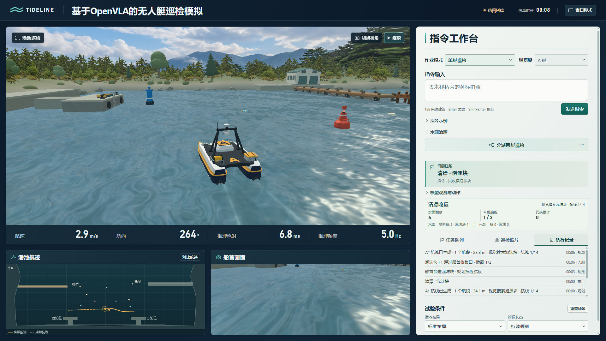
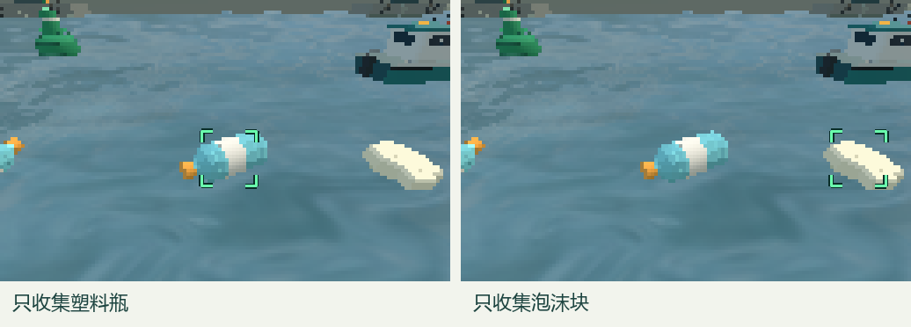
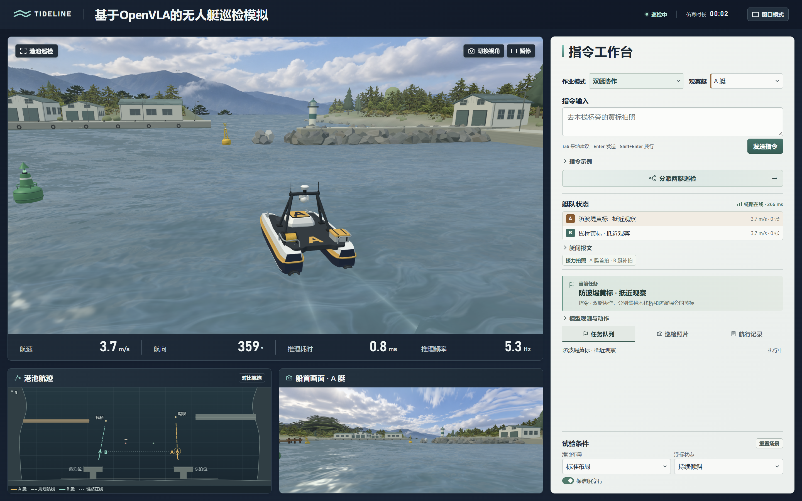

# 基于 OpenVLA 的无人艇巡检模拟

我们开发了这款面向三维港池场景的无人艇巡检模拟软件。操作者可以用中文指挥单艇检查航标、拍照或清理水面漂浮物，也可以给 A、B 两艘艇分派不同的任务。例如，输入“给木栈桥旁的黄标拍照”后，A艇会先规划可航路径，再驶近黄标完成拍摄。电子海图记录航行轨迹，相册自动留存拍摄画面（图 1）。清漂时，艇用船首画面区分塑料瓶和泡沫块，将选中的漂浮物收入舱内，再送回泊位卸载。

**作者**：朱华天，GPT-6.2 Astra，Gemini 4 Neon

**日期**：2026 年 11 月 25 日

[下载 Windows x64 发布版](https://github.com/ZHT1235456/OpenVLA-Based-Unmanned-Surface-Vessel-Inspection-Simulator/releases/latest) · [软件开发日志（PDF）](docs/基于OpenVLA的无人艇巡检模拟软件开发日志.pdf) · [LaTeX 源文件](docs/基于OpenVLA的无人艇巡检模拟软件开发日志.tex)


**图 1**　A艇在木栈桥旁完成拍摄。左下方海图显示已航轨迹，相邻的船首画面中可清晰辨认目标黄标，右侧工作台提示该拍摄任务已完成。

下载发布页的 **Windows x64 中文便携包**，解压后双击 **基于OpenVLA的无人艇巡检模拟.exe**，等待右上角显示“模型就绪”。v1.2.0 的 EXE 大小为 28,298,752 字节（26.99 MiB）。包内附六页中文开发日志，第 5 章用桌面截图和码头实收记录说明水面清漂流程。在已安装 Microsoft Edge WebView2 的 Windows x64 电脑上可离线运行。软件默认全屏，点击右上角“窗口模式”可切换为窗口显示，再次点击可恢复全屏。

## 试一趟巡检

指令输入框中按 Tab 可填入当前显示的建议，光标停在句末，可以继续编辑。按 Enter 发送，按 Shift+Enter 换行。例如，“去木栈桥旁边的绿标拍照”被提示地点有冲突后，按 Tab 可填入“去浮标门的绿标拍照”。

“前往”“巡检”“检查”“观察”默认只航行和观察。需要照片时，在对应步骤写明“拍照”“补拍”或“按下快门”。例如，“先检查红标，再给绿标拍照”只会在绿标处拍一张。“检查栈桥黄标，如果它持续倾斜才补拍”会先测量倾斜，条件成立才启用快门。

航行中单独发送“不要拍照”，当前艇会将原航线上的待拍任务改为观察，继续前往原定目标和泊位。“别拍绿标”只撤销绿标的拍摄安排。

下发航行指令后，每艘艇先从当前位置规划航线。规划器为浮标、栈桥、防波堤和泊位设施留出通行余量。两点之间可直航时采用直线航段，有遮挡时用 A* 在相互可见的航路点之间搜索绕行路径。海图用该艇颜色的虚线显示规划航线，实线显示已航轨迹。航行中遇到保洁船或邻艇时，艇会根据双方的位置和航速让行。改派时重新规划，条件性侧拍和接力补拍则在条件成立或收到回报后规划。日志显示航段数和规划距离，任一航段不可达时艇会停下，工作台提示对应任务。

1. 输入“去木栈桥旁的黄标拍照”，按 Enter 发送。随艇视角下，按住鼠标左键向右拖可向右看，向左拖可向左看。上下拖动调整视角高度，滚轮调整观察距离。也可切换至鸟瞰或船首视角。
2. 航行途中输入“改去防波堤旁那座，栈桥留到回程”。观察任务顺序、航迹和船首画面。展开“模型观测与动作”可以查看送入艇控模型的四张 RGB 裁片、选中的候选和输出动作。
3. 试验条件选“持续倾斜”，发送“先查木栈桥旁的黄标，如果它一直歪着，就换一侧补拍”。在“巡检照片”中点击图片查看大图和保存原图。将状态改为“随浪回正”，从同一起点重跑，观察条件分支。
4. 输入“停船”和“继续任务”可让艇原地等候、恢复待办。“暂停”按钮会冻结整个仿真。重置场景后可叠加同一布局上一次的航迹。
5. 一趟完整任务可输入“从东泊位出发，穿过红绿浮标门，先查木栈桥旁的黄标，再查防波堤内侧那座。每座拍一张全景，如果哪座一直歪着，换到另一侧再拍一张。查完回东泊位”。

在“指令示例”中点击“穿过红绿浮标门，只观察木栈桥旁的黄标，最后返回西泊位”，即可跑一趟不拍照的巡检。任务队列会依次记录过门、抵近观察和靠泊。开启“保洁船穿行”时，遇到横穿航线的保洁船会减速让行。

木栈桥和防波堤旁各有一座黄色巡检浮标，航道浮标门西侧为红标，东侧为绿标。发送“去浮标门的绿标拍照”会驶向东侧门标并拍摄。发送“去木栈桥旁边的绿标拍照”会得到颜色和位置不匹配的说明，整条指令不派单。已有任务由任务队列显示，可用“停船”暂停。

## 水面清漂

每次重置港池，水面上有三个塑料瓶和两块泡沫。展开工作台的“水面清漂”可直接派单，也可以在原来的中文输入框里指定清理对象。

| 可以发送的指令 | 作业结果 |
| --- | --- |
| 只收集泡沫块 | 两块泡沫经船首入舱，送到码头卸载。三个塑料瓶继续漂浮。 |
| 只收集塑料瓶 | 先运回两个，再出航收最后一个。 |
| 清理所有水面漂浮物 | 单艇分三趟卸下五件，最后一趟载一件。 |
| A艇收集塑料瓶，B艇收集泡沫块 | 两艇在同一港池分工，分别回东、西泊位卸载。 |

艇先沿 A* 规划的航线搜索港池。地标和泊位登记在海图上，漂浮物由船首相机发现。海图用椭圆和方块显示仿真中的瓶子和泡沫，艇色圆圈显示相机估计的锁定位置。目标通过开启的船首收集口才计入船舱。每艇可装两件，满舱或完成搜索后返港，停稳才卸载。可指定“装满后返回西泊位卸载”。撤单会保留船上货物，再发“回码头卸载”即可送岸。清漂期间快门关闭。



`cleanup.onnx` 读取固定船首相机的整帧 128×80 RGB 和本艇的中文作业子句。派单器先拆分双艇分工，并把“不要收塑料瓶”等排除条件转成允许收集的类别。模型在画面中选择目标，预测接近速度、转向和收集口开启分数。工作台的“模型观测与动作”可查看实际输入和预测位置。两艇通过艇位报文共享视觉锁定位置。搜索、绕障和返港使用海图，物体类别与真实坐标只供渲染、接触物理、台账及离线监督使用。



清漂策略在实验室 RTX 4090 上使用 420 条仿真轨迹、5,460 帧船首图像训练。另用 96 条轨迹的 1,248 帧逐帧换指令复测。248 帧同时看得见两种材料，其中 221 帧在切换指令后两次均选对，定位误差在 5 像素以内。632 帧无标注目标的画面，两条指令都未触发收集。这些结果来自三维港池仿真。[训练指标](verification/cleanup-training.json) · [换指令与导出一致性](verification/cleanup-export.json)

119 条不同的中文指令共回放 134 次，全部通过。回放覆盖三种港池布局、移动漂浮物、两艇分工、停船改派和指定泊位卸载，累计处理 111,206 帧船首图像，碰撞和拍照均为 0。桌面 EXE 在常速单艇清漂测试中的一次读数为 5.0 次/秒。`npm run test:cleanup` 可重跑视觉闭环，`python scripts/check_cleanup_desktop.py` 可从桌面输入框复验四项收运任务。[视觉清漂回放](verification/cleanup-vision.json) · [桌面实测](verification/cleanup-desktop.json) · [模型面板实测](verification/cleanup-camera-panel.json)

## 双艇通信与协作

作业模式默认为单艇。点击“分派两艇巡检”后，在默认港池布局中，A 艇从东泊位驶向防波堤黄标，B 艇从西泊位驶向木栈桥黄标，两艇都执行抵近观察。切换至“港池鸟瞰”可同时观察两艇，海图上的琥珀色和青绿色分别标示 A、B 两艇的航线。“观察艇”可切换主视角、船首相机、模型观测、任务和相册，另一艘艇会继续执行任务。



| 可输入的指令 | 可以观察到的结果 |
| --- | --- |
| 双艇分别观察栈桥和防波堤的黄标，不用拍照 | 两艘艇各自抵近一个目标并回报任务进度，相册中不会新增照片。 |
| 双艇协作，分别巡检木栈桥和防波堤旁的黄标，最后返回各自泊位 | 根据当前艇位给两艇各分配一个目标，完成后分别回到东西泊位。切换为镜像布局可以看到分工变化。 |
| 接力，A艇只观察栈桥黄标，B艇收到回报再补拍 | A 艇回传观测方位，B 艇收到后规划换侧航段并补拍。两艇合计拍摄一张原片。 |
| 接力复核，A艇拍摄栈桥黄标，B艇接力补拍 | A 艇拍摄并回传全景照，B 艇从另一侧补拍。B 艇相册同时显示收到的全景照和本艇拍的侧面照。 |
| A艇检查栈桥黄标，B艇检查防波堤旁的黄标 | 按艇号改派任务。航线交会时，艇间位置报文用于预测最近会遇距离，B 艇优先让行。 |
| B艇停船 / B艇继续任务 / 双艇取消任务 | 单独控制一艘艇，或向两艘艇广播控制指令。未写艇号的常规指令发给当前观察艇。 |

展开“艇间报文”可看派单、回执、任务进度和影像交接。位置报文每 0.75 仿真秒发送一次，基础单程时延为 0.12 仿真秒，照片另按 500,000 字节/秒计入传输时间。相册区分本艇拍摄与邻艇回传的照片。“暂停”会冻结两艘艇和传输中的报文。切回单艇会结束 B 艇的当前派单。

两艇共用一套艇控权重，各自根据本艇观测在本机推理。一次常速双艇实测中，A 艇每秒推理 5.3 次，B 艇每秒 5.0 次。调度、艇间报文和会遇让行都在同一台电脑上仿真。船首画面随面板尺寸缩放，取证相机将照片单独保存为 720×405 像素的 JPEG。[双艇实测记录](verification/desktop.json)

## 模型与训练

Three.js 渲染三维港池和船首画面，Canvas 2D 绘制电子海图。Vite 打包前端资源，Tauri 2 与 Rust 将前端和模型封装为 Windows 桌面程序，界面由 WebView2 显示。四个 ONNX 模型通过 ONNX Runtime Web 的 WebAssembly 后端在 Web Worker 中运行。

航标巡检策略沿用 OpenVLA 的均匀动作离散化方法。艇控模型在 256 个边界形成的区间上预测归一化航速和转向，同时输出快门信号。发布的是在实验室训练的无人艇专用轻量模型。OpenVLA 论文的 7B 权重面向机器人操作，本项目的中文编码器来自 UER 的两层中文 RoBERTa，视觉网络使用 MobileNetV3-Small 首层卷积初始化。 [OpenVLA，CoRL 2024](https://proceedings.mlr.press/v270/kim25c.html) · [动作编码原始实现](https://github.com/openvla/openvla/blob/main/prismatic/vla/action_tokenizer.py) · [UER 预训练权重](https://huggingface.co/uer/chinese_roberta_L-2_H-128) · [Torchvision MobileNetV3](https://pytorch.org/vision/stable/models/mobilenetv3.html)

- **中文指令**由 language.onnx 识别目标指代。任务管理器处理语句顺序、否定、条件、改派和待办记录。含糊的目标可在输入框重新指定。训练覆盖港池导航、观察、拍照和靠泊用语。
- **艇控**由 navigation.onnx 在本机 Web Worker 执行。模拟器提供实例候选和相对测距测角。光学模拟使用艇所在方位，从与场景相同的地标网格渲染归一化的 20×20 RGB 实例裁片。四个候选按观察方位排列，模型根据裁片、指令目标和相对几何量选择目标并输出运动与拍照动作。船首相机单独渲染全景取证照片。这一设计免去了在真实水面图像上检测候选物的环节。
- **动态任务**使用带惯性的艇体运动、倾角时间序列、低速让行和任务队列。是否再拍取决于观测到的持续倾斜。航道门通过、交通避让、取证站位和任务记忆由显式控制逻辑实现。
- **训练与验证**使用 768 条仿真示范轨迹，共 70,656 个航行状态。验证时更换随机种子，另生成 96 条航迹。语言指代模型在 24 条留出短句中有 23 条正确指向目标。训练和验证使用不同的视觉裁片，导出后逐一核对 ONNX 与 PyTorch 的输出。[训练记录](public/models/run.json) · [闭环验证](verification/closed-loop.json) · [桌面验证](verification/desktop.json)

训练和导出均在配备 NVIDIA GeForce RTX 4090 的实验室服务器上完成，艇控模型使用 PyTorch 2.5.1 训练。发布版随附四个 ONNX 模型和中文词表。[中文指代模型](public/models/language.onnx) · [视觉艇控模型](public/models/navigation.onnx) · [门标艇控模型](public/models/pilot.onnx) · [船首清漂策略](public/models/cleanup.onnx) · [中文词表](public/models/vocab.txt)

红绿门标的身份由海图中与三维模型共用的颜色、位置登记表确定。门标任务把该目标的相对几何量送入 `pilot.onnx`，该文件直接从原艇控网络提取，保留已训练的航速、转向和快门权重。其余四个视觉候选沿用 `navigation.onnx` 的图像注意力。观测选中的实体与派单目标不一致时，艇会减速并复核目标身份。

## 素材库

以下参考均由内置 imagegen 生成。艇体的船首轮廓、护舷与相机桅杆，栈桥桩木、防波堤块石、仓房配色和港池环境按参考图建模。生成图亦用于天空和环境材质。新版界面按双艇控制台设计稿实现。

| 用途 | 原始图 | 生成提示词 |
| --- | --- | --- |
| 港池场景 | [港池全景](design/assets/harbor.png) | [场景与环境提示词](design/assets/environment-prompts.md) |
| 岸线与地标 | [环境素材板](design/assets/environment.png) | [场景与环境提示词](design/assets/environment-prompts.md) |
| 巡检无人艇 | [艇体四视图](design/assets/vessel.png) | [艇体提示词](design/assets/vessel-prompt.md) |
| 初版控制台 | [界面设计稿](design/assets/interface.png) | [界面提示词](design/assets/interface-prompt.md) |
| 双艇控制台 | [新版界面设计稿](design/assets/interface-fleet.png) | [新版界面提示词](design/assets/interface-fleet-prompt.md) |

## 开发与复验

在本项目目录执行以下命令。Windows 桌面构建需要 Rust MSVC 和 Visual Studio C++ Build Tools。

```powershell
npm ci
npm run dev
npm run test:commands
npm run desktop
```

Vite 开发地址为 `http://127.0.0.1:5186/`，`npm run build` 生成可通过 HTTP 静态服务浏览的 `dist/`。桌面构建在项目根目录生成正式中文名的 EXE。

如需重新编译开发日志，在装有 TeX Live 和 Fandol 字体的环境中进入 `docs/`，对同名 `.tex` 源文件连续运行两次 `lualatex`，即可生成可搜索、可复制中文的发布版 PDF。该源文件也可用 XeLaTeX 编译。

仿真闭环与桌面复验脚本使用 Python、Playwright、Pillow 和本机 Edge。先启动 Vite，以 `python scripts/check_sim.py` 检验单艇，以 `python scripts/check_sim.py --fleet` 检验双艇。双艇用例包含三种布局的分工、交叉让行、双向接力、倾斜条件、暂停恢复以及照片传输期间撤单。[双艇闭环结果](verification/fleet.json)

执行 `python scripts/check_sim.py --sky` 会载入实际天空材质，在 24 个方位、7 个仰角逐一比较相邻采样射线的颜色。桌面复验还会发送“去木栈桥旁边的绿标拍照”，确认没有派单，再发送“去浮标门的绿标拍照”，检验船首照片中央的颜色。[环视检测](verification/sky.json) · [栈桥边朝正南的模拟画面](verification/sky-south.png) · [绿标拍摄原图](verification/gate-green.jpg)

执行 `python scripts/check_desktop.py` 从独立工作目录启动发布的 EXE，检验原生窗口、暂停缩放时船首画布四边的实际像素、中文连续派单、保存原图、航迹对比及双艇协作。测试会比对两艇相册收到的 JPEG 哈希。[桌面检测结果](verification/desktop.json) · [双艇分工截图](verification/fleet-desktop.png) · [接力交接截图](verification/fleet-handoff.png)

执行 `python scripts/check_commands.py` 可从发布版 EXE 的输入框复验 177 条中文指令。按 CEGIS 的做法，先用 143 条指令回放并调整派单规则，再用 34 条独立留出的指令检验。发布版回放的 177 条均符合预期，其中 151 条执行，26 条按预期拒绝派单。测试按艇核对了 164 次起航前规划，解码校验了 83 张船首 JPEG，艇间回传的副本另行比对。使用 `--ids C046,C085` 可复验单艇检查和双艇巡检的零照片结果，使用 `--ids C175` 可复验 A 艇观察、B 艇补拍一张的接力任务。[逐条测试报告](verification/commands-final.md) · [测试规格](scripts/cegis_cases.py)

在 v1.2.0 的 Windows EXE 上再次回放 177 条巡检指令，全部通过。发布版完成了 164 次起航前规划，并按要求拍摄 83 张 JPEG。[v1.2.0 逐条回归记录](verification/commands-v1.2.0.json)

复训时，以 `python training/prepare_base.py` 获取初始权重和词表，以 `python scripts/collect_views.py` 从开发服务器采集实际使用的相机裁片。将基础权重、词表和 `visual.bank` 放入服务器同一 `data/` 目录，准备 `out/`。在含有 CUDA PyTorch 与 NumPy 的环境中运行训练，以安装有 PyTorch、ONNX 和 ONNX Runtime 的环境导出。

```sh
python training/train.py --data data --out out
python training/export.py --data data --out out
```

清漂的采集器使用与 EXE 相同的船首相机。启动 `npm run dev -- --port 5193` 后，在另一终端运行以下两条命令。第二批轨迹加入近距离邻艇和遮挡。

```sh
python scripts/collect_cleanup.py --out data
python scripts/collect_cleanup.py --neighbor --train 150 --holdout 36 --out data
```

将这些数据分片复制到 GPU 服务器的 `data/` 目录。在仓库根目录训练策略、导出权重，再用独立轨迹比对 PyTorch 与 ONNX 并核验同帧换指令结果。

```sh
python training/cleanup_policy.py --data data --out out --steps 1750 --lexicon public/models/cleanup-lexicon.json
python training/cleanup_policy.py --export --out out --lexicon public/models/cleanup-lexicon.json
python training/check_cleanup_export.py --data data --out out --lexicon public/models/cleanup-lexicon.json
```
