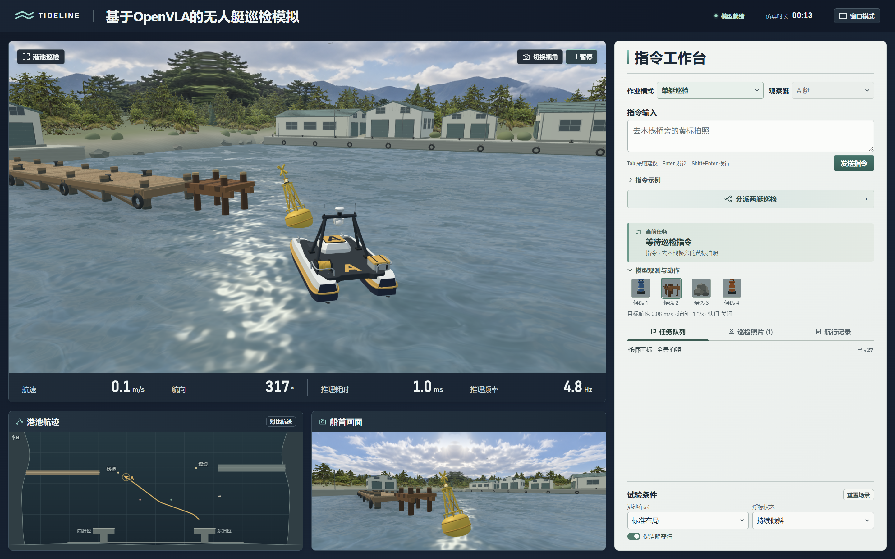

# 基于OpenVLA的无人艇巡检模拟

用中文给港池中的无人艇下达巡检指令，观察它如何规划航线、核对浮标位置，并按要求拍照或与另一艘艇接力。

[下载 Windows x64 发布版](https://github.com/ZHT1235456/OpenVLA-Based-Unmanned-Surface-Vessel-Inspection-Simulator/releases/latest) · [软件开发日志（PDF）](docs/基于OpenVLA的无人艇巡检模拟软件开发日志.pdf) · [LaTeX 源文件](docs/基于OpenVLA的无人艇巡检模拟软件开发日志.tex)

下载发布页的 **Windows x64 中文便携包**，解压后双击 **基于OpenVLA的无人艇巡检模拟.exe**，等待右上角显示“模型就绪”。包内附有中文开发日志 PDF。Windows 应用默认全屏，右上角“窗口模式”可以还原窗口，同一位置可重新进入全屏。模型、港池和推理运行时均内置于 EXE。在具备 Microsoft Edge WebView2 的 Windows x64 电脑上可离线运行。



## 试一趟巡检

指令输入框中按 Tab 可填入当前显示的建议，光标停在句末，可以继续编辑。按 Enter 发送，按 Shift+Enter 换行。例如，“去木栈桥旁边的绿标拍照”被提示地点有冲突后，按 Tab 可填入“去浮标门的绿标拍照”。

“前往”“巡检”“检查”“观察”默认只航行和观察。需要照片时，在对应步骤写明“拍照”“补拍”或“按下快门”。例如，“先检查红标，再给绿标拍照”只会在绿标处拍一张。“检查栈桥黄标，如果它持续倾斜才补拍”会先测量倾斜，条件成立才启用快门。

航行中单独发送“不要拍照”，当前艇会将原航线上的待拍任务改为观察，继续前往原定目标和泊位。“别拍绿标”只撤销绿标的拍摄安排。

下发航行指令后，每艘艇先从当前位置用 A* 计算各航段，在海图上用该艇颜色的虚线显示规划航线，实线显示已航轨迹。规划会给浮标、栈桥、防波堤和泊位设施留出间距。艇控模型沿航路点接近作业位置，遇到保洁船或邻艇仍会实时让行。改派会重新规划，条件性侧拍和接力任务会在条件成立或收到回报后再计算作业航线。日志显示航段数和规划距离，任一航段不可达时艇会停下，并显示对应任务。

1. 输入“去木栈桥旁的黄标拍照”，按 Enter 发送。随艇视角下，按住鼠标左键向右拖可向右看，向左拖可向左看。上下拖动调整视角高度，滚轮调整观察距离。也可切换至鸟瞰或船首视角。
2. 航行途中输入“改去防波堤旁那座，栈桥留到回程”。观察任务顺序、航迹和船首画面。展开“模型观测与动作”可以查看送入艇控模型的四张 RGB 裁片、选中的候选和输出动作。
3. 试验条件选“持续倾斜”，发送“先查木栈桥旁的黄标，如果它一直歪着，就换一侧补拍”。在“巡检照片”中点击图片查看大图和保存原图。将状态改为“随浪回正”，从同一起点重跑，观察条件分支。
4. 输入“停船”和“继续任务”可让艇原地等候、恢复待办。“暂停”按钮会冻结整个仿真。重置场景后可叠加同一布局上一次的航迹。
5. 一趟完整任务可输入“从东泊位出发，穿过红绿浮标门，先查木栈桥旁的黄标，再查防波堤内侧那座。每座拍一张全景，如果哪座一直歪着，换到另一侧再拍一张。查完回东泊位”。

在“指令示例”中点击“穿过红绿浮标门，只观察木栈桥旁的黄标，最后返回西泊位”，即可跑一趟不拍照的巡检。任务队列会依次记录过门、抵近观察和靠泊。开启“保洁船穿行”时，遇到横穿航线的保洁船会减速让行。

木栈桥和防波堤旁各有一座黄色巡检浮标，航道浮标门西侧为红标，东侧为绿标。发送“去浮标门的绿标拍照”会驶向东侧门标并拍摄。发送“去木栈桥旁边的绿标拍照”会得到颜色和位置不匹配的说明，整条指令不派单。已有任务由任务队列显示，可用“停船”暂停。

## 双艇通信与协作

作业模式默认是单艇。点击“分派两艇巡检”即可立即进入双艇协作。A 艇从东泊位出发，船身为琥珀色，B 艇从西泊位出发，船身为海绿色。“观察艇”可切换主视角、船首相机、模型观测、任务和相册，另一艘艇会继续执行派单。


| 可输入的指令 | 可以观察到的结果 |
| --- | --- |
| 双艇分别观察栈桥和防波堤的黄标，不用拍照 | 两艘艇各自抵近一个目标并回报任务进度，相册中不会新增照片。 |
| 双艇协作，分别巡检木栈桥和防波堤旁的黄标，最后返回各自泊位 | 根据当前艇位给两艇各分配一个目标，完成后分别回到东西泊位。切换为镜像布局可以看到分工变化。 |
| 接力复核，A艇检查栈桥黄标，B艇接力补拍 | A 艇回传观测方位后返航。B 艇根据回报换侧，只有 B 艇拍一张。 |
| A艇拍摄栈桥黄标，B艇接力补拍 | A 艇拍摄并回传全景照片，B 艇收到影像后从另一侧补拍。可加上“如果发现倾斜才补拍”来限定 B 艇的拍摄条件。 |
| A艇检查栈桥黄标，B艇检查防波堤旁的黄标 | 按艇号改派任务。航线交会时，艇间位置报文用于预测最近会遇距离，B 艇优先让行。 |
| B艇停船 / B艇继续任务 / 双艇取消任务 | 单独控制一艘艇，或向两艘艇广播控制指令。未写艇号的常规指令发给当前观察艇。 |

展开“艇间报文”可看派单、回执、任务进度和影像交接。位置报文每 0.75 仿真秒发送一次，基础单程时延为 0.12 仿真秒，照片另按 500,000 字节/秒计入传输时间。相册区分本艇拍摄与邻艇回传的照片。“暂停”会冻结两艘艇和传输中的报文。切回单艇会结束 B 艇的当前派单。

两艇各自根据本艇视点的 RGB 裁片和几何观测执行本地 ONNX 推理，共用一套已训练的权重。调度、可靠报文和会遇让行在同一台电脑上仿真。船首相机根据面板尺寸调整投影和像素缓冲，全屏、窗口和暂停状态下均可缩放。取证相机单独保存 720×405 JPEG。

## 模型与训练

本项目沿用 OpenVLA 的均匀动作离散化方法。艇控模型在 256 个边界形成的区间上预测归一化航速和转向，同时输出快门信号。发布的是在实验室训练的无人艇专用轻量模型。OpenVLA 论文的 7B 权重面向机器人操作，本项目的中文编码器来自 UER 的两层中文 RoBERTa，视觉网络使用 MobileNetV3-Small 首层卷积初始化。 [OpenVLA，CoRL 2024](https://proceedings.mlr.press/v270/kim25c.html) · [动作编码原始实现](https://github.com/openvla/openvla/blob/main/prismatic/vla/action_tokenizer.py) · [UER 预训练权重](https://huggingface.co/uer/chinese_roberta_L-2_H-128) · [Torchvision MobileNetV3](https://pytorch.org/vision/stable/models/mobilenetv3.html)

- **中文指令**由 language.onnx 识别目标指代。任务管理器处理语句顺序、否定、条件、改派和待办记录。含糊的目标可在输入框重新指定。训练覆盖港池导航、观察、拍照和靠泊用语。
- **艇控**由 navigation.onnx 在本机 Web Worker 执行。模拟器提供实例候选和相对测距测角。光学模拟使用艇所在方位，从与场景相同的地标网格渲染归一化的 20×20 RGB 实例裁片。四个候选按观察方位排列，模型根据裁片、指令目标和相对几何量选择目标并输出运动与拍照动作。船首相机单独渲染全景取证照片。这一设计免去了在真实水面图像上检测候选物的环节。
- **动态任务**使用带惯性的艇体运动、倾角时间序列、低速让行和任务队列。是否再拍取决于观测到的持续倾斜。航道门通过、交通避让、取证站位和任务记忆由显式控制逻辑实现。
- **训练记录**包含 768 条带改派的仿真示范、70,656 个航行状态。另用 96 条不同随机布局的航迹做验证。视角训练和验证分别使用不同的裁片。服务端分别检查 ONNX 图，并对照 PyTorch 输出。训练与导出指标见 [训练记录](public/models/run.json)，端到端用例见 [闭环验证](verification/closed-loop.json)，真机窗口与延迟结果见 [桌面验证](verification/desktop.json)。

训练和导出均在配备 NVIDIA GeForce RTX 4090 的实验室服务器上完成。发布版使用仓库内的 [中文 ONNX](public/models/language.onnx)、[艇控 ONNX](public/models/navigation.onnx)、[门标艇控 ONNX](public/models/pilot.onnx) 和[中文词表](public/models/vocab.txt)。

红绿门标的身份由海图中与三维模型共用的颜色、位置登记表确定。门标任务把该目标的相对几何量送入 `pilot.onnx`，该文件直接从原艇控网络提取，保留已训练的航速、转向和快门权重。其余四个视觉候选沿用 `navigation.onnx` 的图像注意力。观测选中的实体与派单目标不一致时，艇会减速并复核目标身份。

## 素材库

以下参考均由内置 imagegen 生成。艇体的船首轮廓、护舷与相机桅杆，栈桥桩木、防波堤块石、仓房配色和港池环境按参考图建模。生成图亦用于天空和环境材质。新版界面按双艇控制台设计稿实现。

| 用途 | 原始图 | 生成提示词 |
| --- | --- | --- |
| 港池场景 | [港池全景](design/assets/harbor.png) | [场景与环境提示词](design/assets/environment-prompts.md) |
| 岸线与地标 | [环境素材板](design/assets/environment.png) | [场景与环境提示词](design/assets/environment-prompts.md) |
| 巡检无人艇 | [艇体四视图](design/assets/vessel.png) | [艇体提示词](design/assets/vessel-prompt.md) |
| 初版控制台 | [界面设计稿](design/assets/interface.png) | [界面提示词](design/assets/interface-prompt.md) |
| 双艇控制台 | [新版界面设计稿](design/assets/interface-fleet.png) | [新版界面提示词](design/assets/interface-fleet-prompt.md) |

## 开发与复验

在本项目目录执行以下命令。Windows 桌面构建需要 Rust MSVC 和 Visual Studio C++ Build Tools。

```powershell
npm ci
npm run dev
npm run test:commands
npm run desktop
```

Vite 开发地址为 `http://127.0.0.1:5186/`，`npm run build` 生成可通过 HTTP 静态服务浏览的 `dist/`。桌面构建在项目根目录生成正式中文名的 EXE。

开发日志初稿和前期修订使用了 agy CLI 的 `gemini-4-hydrogen-high`。本次由该模型通读并提出校读意见，再结合软件运行截图改写正文和图注。在装有 TeX Live 和 Fandol 字体的环境中进入 `docs/`，对同名 `.tex` 源文件连续运行两次 `xelatex`，即可重建带图号和文献链接的 PDF。

仿真闭环与桌面复验脚本使用 Python、Playwright、Pillow 和本机 Edge。先启动 Vite，以 `python scripts/check_sim.py` 检验单艇，以 `python scripts/check_sim.py --fleet` 检验双艇。双艇用例包含三种布局的分工、交叉让行、双向接力、倾斜条件、暂停恢复以及照片传输期间撤单。[双艇闭环结果](verification/fleet.json)

执行 `python scripts/check_sim.py --sky` 会载入实际天空材质，在 24 个方位、7 个仰角逐一比较相邻采样射线的颜色。桌面复验还会发送“去木栈桥旁边的绿标拍照”，确认没有派单，再发送“去浮标门的绿标拍照”，检验船首照片中央的颜色。[环视检测](verification/sky.json) · [栈桥边朝正南的模拟画面](verification/sky-south.png) · [绿标拍摄原图](verification/gate-green.jpg)

执行 `python scripts/check_desktop.py` 从独立工作目录启动发布的 EXE，检验原生窗口、暂停缩放时船首画布四边的实际像素、中文连续派单、保存原图、航迹对比及双艇协作。测试会比对两艇相册收到的 JPEG 哈希。[桌面检测结果](verification/desktop.json) · [双艇分工截图](verification/fleet-desktop.png) · [接力交接截图](verification/fleet-handoff.png)

执行 `python scripts/check_commands.py` 可通过发布版 EXE 的输入框复验 177 条不同的中文指令，其中 143 条用于发现反例，34 条独立留出。用例预先指定艇号、目标、动作顺序和条件分支。每次复验会核对实际任务与相册，等待真实 ONNX 推理，解码每张船首 JPEG，并核对双艇回传的影像。使用 `--ids C046,C085` 可复验单艇检查和双艇巡检的零照片结果，使用 `--ids C175` 可复验首艇观察、另一艘艇补拍。[逐条测试报告](verification/commands-final.md) · [测试规格](scripts/cegis_cases.py)

复训时，以 `python training/prepare_base.py` 获取初始权重和词表，以 `python scripts/collect_views.py` 从开发服务器采集实际使用的相机裁片。将基础权重、词表和 `visual.bank` 放入服务器同一 `data/` 目录，准备 `out/`。在含有 CUDA PyTorch 与 NumPy 的环境中运行训练，以安装有 PyTorch、ONNX 和 ONNX Runtime 的环境导出。

```sh
python training/train.py --data data --out out
python training/export.py --data data --out out
```
